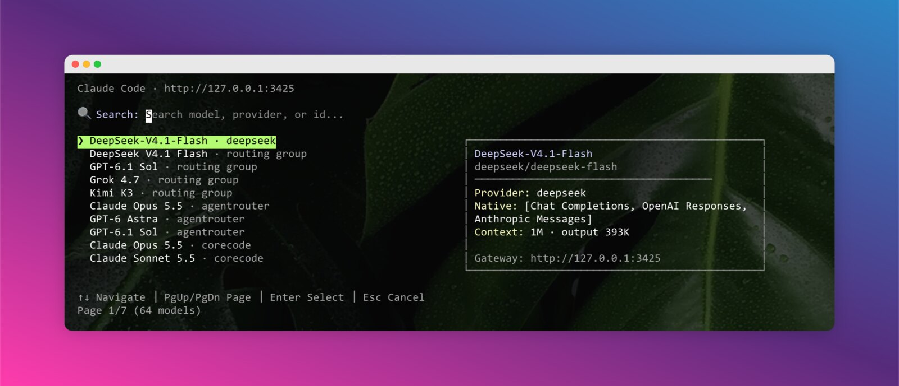

# magpick - Model Picker for the Magpie Gateway

[中文](README.zh-CN.md)

A convenient model picker for Claude Code and Codex CLI, backed by [Magpie](https://github.com/yetone/magpie). Choose a model (`provider/model`) or a routing group from your gateway, then launch the target CLI with an isolated, session-only configuration.

## Why this project?

If you use [Magpie](https://github.com/yetone/magpie) to manage providers and models, you still have to tell each CLI which model to use. The usual approaches are awkward:

1. **Global config changes affect running sessions** - Editing `~/.claude/settings.json` or `~/.codex/config.toml` changes every instance, including the ones already running.
2. **One model at a time** - All sessions share the same configuration, so comparing two models in parallel means manual edits and restarts.
3. **A provider is not a model** - Magpie providers are not split into "Claude" and "Codex" buckets. A provider exposes protocol endpoints (`anthropic`, `chat`, `responses`, `gemini`), and the gateway translates between them, so the thing you actually pick is a model.

magpick is an interactive terminal picker - search, arrow keys, a preview panel and history - plus:

- **Environment isolation** - Only affects processes launched by magpick, not global settings or other running instances.
- **No config pollution** - Never modifies `~/.claude/settings.json` or `~/.codex/config.toml`.
- **Session-level model selection** - Each terminal session can use a different model.
- **Multi-CLI support** - Works with both Claude Code and Codex CLI.
- **Protocol awareness** - Only lists models that can natively serve the selected agent's API.
- **Quick switching** - Fast interactive selection without opening a GUI.



Use cases:

- Working on multiple projects that need different models (cheap/fast vs. deep reasoning).
- Testing the same codebase against different models in parallel.
- Using one Magpie gateway for both Claude Code and Codex CLI.

## Features

- 🖥️ **Cross-platform** - Supports macOS, Linux, Windows
- 📦 **Easy to install** - Single npm package, no native modules
- 🔍 **Interactive UI** - Search across model id, display name, provider and label
- 👀 **Preview panel** - View provider, native protocols, context window and max output before selecting
- 📜 **History** - Recently used models appear at the top, tracked separately per agent
- ⌨️ **Keyboard navigation** - Full keyboard support including Page Up/Down
- 🔄 **Passthrough arguments** - All arguments are passed directly to the target CLI
- 🤖 **Multi-CLI** - Supports both Claude Code and Codex CLI
- 🧭 **Protocol-aware list** - Claude Code sees Anthropic Messages models, Codex sees Responses models, routing groups are always listed
- 🧹 **Clean teardown** - `--clear` removes every generated config
- 🧪 **Scriptable** - `--json` prints the model catalog without launching

## Prerequisites

- Node.js >= 18.0.0
- [Magpie](https://github.com/yetone/magpie) installed and its gateway running (menu bar app, `magpie serve`, or `magpie daemon`)
- [Claude CLI](https://claude.ai/code) and/or [Codex CLI](https://github.com/openai/codex) installed
- The gateway must expose `GET /v1/models` and, for Codex, `GET /v1/codex/models`

## Installation

magpick is not published to npm yet (`v0.1.0`). Install from source:

```bash
# Clone the repository
git clone https://github.com/terranc/magpick.git
cd magpick

# Install dependencies and build
npm install
npm run build

# Put `magpick` on your PATH
npm link
```

`npm link` writes into your global npm prefix; if that directory is not writable, use `npm install -g .` from the repository instead.

Or run it without linking:

```bash
node dist/index.js
```

### Verify the setup

```bash
magpick --json | head -20
```

A `models` array means the gateway is reachable and at least one model is enabled. An error, or an empty list, means Magpie is not running, has no provider enabled, or the gateway address is wrong.

## Usage

### Launch Claude Code

```bash
magpick              # interactive model selection → launch Claude Code
magpick claude       # same as above
```

### Launch Codex CLI

```bash
magpick codex        # interactive model selection → launch Codex
```

### Keyboard shortcuts

| Key | Function |
|-----|----------|
| `↑` / `↓` | Navigate model list (wraps around) |
| `PgUp` / `PgDn` | Page navigation (10 per page) |
| `Enter` | Confirm selection and launch |
| `Esc` | Cancel |
| `Type text` | Search/filter models |

### Passing arguments

All arguments after the subcommand are passed directly to the target CLI:

```bash
# Claude Code
magpick --continue
magpick --print "Explain this repository"

# Codex CLI
magpick codex --full-auto
```

magpick's own flags (`--gateway`, `--json`, `--clear`) are stripped before forwarding. When the target CLI needs an argument with the same name, put `--` in front of it: everything after `--` is forwarded untouched, and the `--` itself is not passed on.

```bash
magpick codex -- --json     # --json reaches Codex, not magpick
```

### Inspect the model catalog

```bash
magpick --json
magpick codex --json
```

Prints `{ agent, gateway, models }` after protocol filtering and history sorting, then exits without launching.

### Override the gateway

```bash
magpick --gateway http://192.168.1.10:3425
magpick --gateway=http://192.168.1.10:3425
```

### Clear generated config files

```bash
magpick --clear
```

Removes `~/.claude/magpick-*.settings.json` and `~/.magpick/codex/*`. Global Claude/Codex configs, Magpie configs and `~/.magpick-history` are kept.

### Help

```bash
magpick --help
magpick codex --help     # magpick's help for the codex subcommand
```

For the target CLI's own help, call it directly: `claude --help` / `codex --help`.

## How it works

### Claude Code

magpick writes `~/.claude/magpick-<slug>-<hash>.settings.json`, based on your `~/.claude/settings.json`, preserving hooks, plugins, permissions, status line and other settings. Conflicting Anthropic environment keys are replaced, and it sets:

```text
model
env.ANTHROPIC_BASE_URL
env.ANTHROPIC_AUTH_TOKEN
env.ANTHROPIC_DEFAULT_{HAIKU,SONNET,OPUS,FABLE}_MODEL
env.ANTHROPIC_SMALL_FAST_MODEL
```

Any inherited `env.ANTHROPIC_MODEL` is cleared so the top-level `model` wins. `CLAUDE_CODE_MAX_CONTEXT_TOKENS` is set from the context window the model reports, capped at 1M, so large-context models are not held to Claude Code's 200K default for unrecognized model ids. Then magpick launches `claude --settings=<file>`. The global settings file is never modified.

### Codex

magpick creates `~/.magpick/codex/<slug>-<hash>/` containing:

- `config.toml` - `model_provider = "magpie"`, the selected `model`, `model_catalog_json`, a `[model_providers.magpie]` block pointing at the gateway, and your other Codex settings (conflicting top-level keys and any previous `[model_providers.magpie]` section are removed).
- `magpie-models.json` - the catalog fetched from `GET /v1/codex/models`.

Then magpick launches `codex` with `CODEX_HOME` pointing at that directory.

### Preview panel

The preview panel describes the highlighted model:

```text
┌────────────────────────────────────────┐
│ DeepSeek V4.1 Flash                    │
│ auto/deepseek-v4.1-flash               │
│ ────────────────────────────────────── │
│ Provider: cpi · routing group          │
│ Native: translated by magpie           │
│ Context: 1M · output 384K              │
│ Gateway: http://127.0.0.1:3425         │
└────────────────────────────────────────┘
```

`Native` lists the protocols the model serves natively, read from `native_endpoints` in `/v1/models`:

- `Anthropic Messages` - `/v1/messages`
- `OpenAI Responses` - `/v1/responses`
- `Chat Completions` - `/v1/chat/completions`
- `Gemini` - Gemini API (`/v1beta`)

They are shown in brackets, e.g. `Native: [Anthropic Messages, Chat Completions]`. When a model has no native endpoint the panel says `translated by magpie`, meaning the gateway converts the request.

### Model list

Each row reads `model name · provider`, with the provider or `routing group` suffix dimmed:

```text
 DeepSeek V4.1 Flash · routing group
 GPT-6 Astra · agentrouter
```

Because the agent is already known, the picker only lists models that serve that agent's protocol natively - `/v1/messages` for Claude Code, `/v1/responses` for Codex. Routing groups (`auto/...`) have no protocol of their own since Magpie picks a member per request, so they are always listed.

The list is also de-duplicated. Magpie serves the same entry under several ids - a routing group as `auto/<name>` plus a bare alias, a model as `provider/model` plus a short alias - so magpick keeps one row per (provider, display name), preferring `provider/model`, then `auto/<name>`, then the bare alias. Same-named models from different providers stay separate.

## Environment variables

| Variable | Description | Default |
|----------|-------------|---------|
| `MAGPIE_GATEWAY` | Full Magpie gateway URL | - |
| `MAGPIE_ADDR` | Gateway `host:port` | - |
| `MAGPIE_GATEWAY_KEY` | Gateway key; required for non-loopback gateways | `magpie` (loopback only) |

Gateway resolution order:

1. `--gateway <url>`
2. `MAGPIE_GATEWAY` (full URL)
3. `MAGPIE_ADDR` (`host:port`)
4. `http://127.0.0.1:3425`

A missing scheme defaults to `http://`, a trailing `/v1` is stripped, and `0.0.0.0:<port>` / `[::]:<port>` are rewritten to `127.0.0.1`.

### Remote gateway configuration

```bash
# macOS / Linux
export MAGPIE_GATEWAY=http://192.168.1.10:3425
export MAGPIE_GATEWAY_KEY=your-gateway-key

# Windows (PowerShell)
$env:MAGPIE_GATEWAY = "http://192.168.1.10:3425"
$env:MAGPIE_GATEWAY_KEY = "your-gateway-key"
```

Create the key in Magpie. Loopback requests use the local `magpie` token and need no configuration.

## Troubleshooting

| Symptom | Cause | Fix |
|---------|-------|-----|
| `Cannot reach Magpie gateway at <url>` | Gateway not running, or wrong address | Start Magpie (menu bar app, `magpie serve`, `magpie daemon`), or pass `--gateway <url>` |
| `Magpie returned HTTP 401` | Remote gateway without a key | `export MAGPIE_GATEWAY_KEY=<key>` |
| `Magpie returned no models` | No provider or model enabled in Magpie | Add a provider and enable at least one model |
| `No models natively serve the ... API` | Nothing enabled exposes that protocol | Enable a model whose `native_endpoints` include `/v1/messages` (Claude Code) or `/v1/responses` (Codex) |
| `Magpie returned an invalid Codex catalog` | Magpie too old, or `/v1/codex/models` missing | Update Magpie |
| A model is missing from the list | Filtered out by protocol, or merged into a duplicate row | Check `magpick --json`; groups are always listed, same-provider duplicates collapse into one row |
| Nothing matches while typing | Search is too narrow | Clear the search box |

## History

Model usage history is stored in `~/.magpick-history` as `timestamp<TAB>agent<TAB>modelId`. Recently used models are displayed at the top of the list for the matching agent; untouched entries are ordered with routing groups first, then by provider and name.

## Development

```bash
# Install dependencies
npm install

# Build once, or watch
npm run build
npm run dev

# Local test
node dist/index.js --json
node dist/index.js

# Type check
npm run typecheck
```

`README.md` and `README.zh-CN.md` are kept in sync - when you change one, change the other.

## Tech stack

- [Ink](https://github.com/vadimdemedes/ink) - React for CLI
- [ink-text-input](https://github.com/vadimdemedes/ink-text-input) - Text input component
- [React](https://react.dev/) - UI runtime
- [commander](https://github.com/tj/commander.js) - CLI framework
- TypeScript with Node.js built-ins for config files and process spawning

## Safety

- magpick never reads provider API keys; it only reads the gateway's model catalog.
- It never writes `~/.claude/settings.json` or `~/.codex/config.toml`.
- Generated files are written with mode `0600`.
- `magpick --clear` removes only `~/.claude/magpick-*.settings.json` and `~/.magpick/codex/`.

## Links

- [Magpie](https://github.com/yetone/magpie)
- [ccsc](https://github.com/terranc/ccsc) - sibling project: the same picker for CC Switch providers
- [Linux Do](https://linux.do/)

## License

MIT
