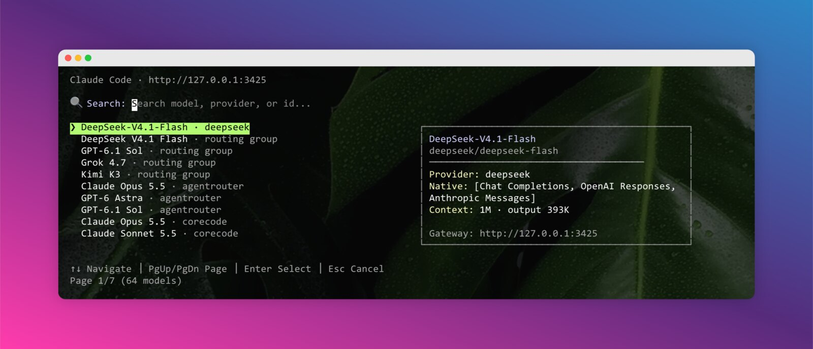

# magpick - Magpie 网关模型选择器

[English](README.md)

一个为 Claude Code、Codex CLI、Pi、Kimi Code、OpenCode 和 ZCode 提供便利的模型选择器，模型目录来自 [Magpie](https://github.com/yetone/magpie)。从网关中选择一个模型（`provider/model`）或路由组，然后以隔离的、仅当前会话生效的配置启动目标 CLI。

## 为什么做这个项目？

如果你用 [Magpie](https://github.com/yetone/magpie) 管理服务商和模型，仍然需要告诉每个 CLI 用哪个模型。常见做法都不太方便：

1. **修改全局配置会影响正在运行的会话** - 改动 `~/.claude/settings.json` 或 `~/.codex/config.toml` 会作用于所有实例，包括已经跑起来的那些。
2. **同一时间只能用一个模型** - 所有会话共享同一份配置，想并行对比两个模型就得手动改配置、重启。
3. **服务商不等于模型** - Magpie 的服务商并不按 “Claude” 和 “Codex” 分类；一个服务商暴露的是协议端点（`anthropic`、`chat`、`responses`、`gemini`），网关负责在协议之间转换。所以你真正要选的是模型。

magpick 是一个交互式终端选择器：搜索、方向键、预览面板、历史记录，另外还提供：

- **环境隔离** - 只影响 magpick 启动的进程，不改变全局设置，也不影响其他正在运行的实例。
- **不污染配置** - 从不修改 `~/.claude/settings.json` 或 `~/.codex/config.toml`。
- **会话级模型选择** - 每个终端会话都可以使用不同的模型。
- **多 CLI 支持** - 同时支持 Claude Code、Codex CLI、Pi、Kimi Code、OpenCode 和 ZCode。
- **协议感知** - 只列出能为所选 agent 的 API 提供原生服务的模型。
- **快速切换** - 无需打开 GUI，在终端里交互式选择。



适用场景：

- 多个项目需要不同模型（便宜/快速 vs. 深度推理）。
- 并行用不同模型测试同一份代码。
- 一个 Magpie 网关同时服务机器上的所有编码 agent。

## 功能特性

- 🖥️ **跨平台** - 支持 macOS、Linux、Windows
- 📦 **安装简单** - 单个 npm 包，无原生模块
- 🔍 **交互式界面** - 按模型 id、显示名、服务商和标签搜索
- 👀 **预览面板** - 选择前查看服务商、原生协议、上下文窗口和最大输出
- 📜 **历史记录** - 最近使用的模型排在最前，并按 agent 分别记录
- ⌨️ **键盘导航** - 完整键盘支持，含 Page Up/Down
- 🔄 **参数透传** - 所有参数原样传给目标 CLI
- 🤖 **多 CLI** - 同时支持 Claude Code、Codex CLI、Pi、Kimi Code、OpenCode 和 ZCode
- 🧭 **协议感知列表** - 每个 agent 只看到自己能原生服务的协议，路由组始终显示
- 🧹 **干净清理** - `--clear` 删除所有生成的配置
- 🧪 **可脚本化** - `--json` 直接打印模型目录，不启动 CLI

## 环境要求

- Node.js >= 18.0.0
- 已安装 [Magpie](https://github.com/yetone/magpie) 且网关正在运行（菜单栏应用、`magpie serve` 或 `magpie daemon`）
- 至少安装一个受支持的 CLI：
  - [Claude Code](https://claude.ai/code)
  - [Codex CLI](https://github.com/openai/codex)
  - Pi（`pi`），已在 1.5.2 验证
  - [Kimi Code](https://moonshotai.github.io/kimi-code/) - 新版 `kimi` CLI（`~/.kimi-code`），已在 2.2.0 验证；不支持旧版 `kimi-cli`（`~/.kimi`）
  - [OpenCode](https://opencode.ai/) - 已在 2.2.5 验证，仅支持 v2 配置 schema
  - ZCode - 已按 `zcode-app-cli@3.18.1-46` 验证；不支持 ZCode Desktop
- 网关需暴露 `GET /v1/models`，Codex 还需要 `GET /v1/codex/models`

## 安装

magpick 尚未发布到 npm（`v0.1.0`）。请从源码安装：

```bash
# 克隆仓库
git clone https://github.com/terranc/magpick.git
cd magpick

# 安装依赖并构建
npm install
npm run build

# 将 `magpick` 加入 PATH
npm link
```

`npm link` 会写入全局 npm 前缀目录；如果该目录不可写，改用仓库内的 `npm install -g .`。

不 link 也可以直接运行：

```bash
node dist/index.js
```

### 验证安装

```bash
magpick --json | head -20
```

能打印出 `models` 数组，说明网关可达且至少启用了一个模型。报错或列表为空，说明 Magpie 没在运行、没有启用服务商，或者网关地址不对。

## 使用

### 启动 Claude Code

```bash
magpick              # 交互选择模型 → 启动 Claude Code
magpick claude       # 同上
```

### 启动 Codex CLI

```bash
magpick codex        # 交互选择模型 → 启动 Codex
```

### 启动 Pi

```bash
magpick pi
```

magpick 会生成隔离的 `PI_CODING_AGENT_DIR`，其中镜像你原有的 settings、auth、MCP、extensions、skills 和 sessions，并写入指向所选模型的 `models.json`。

### 启动 Kimi Code

```bash
magpick kimi
magpick kimi-code    # 别名
```

Kimi Code 通过 `KIMI_MODEL_*` 环境变量读取模型，因此 magpick 不写配置文件，`~/.kimi-code` 中的会话和设置保持不变。

### 启动 OpenCode

```bash
magpick opencode
```

magpick 传入仅当前会话生效的 `OPENCODE_CONFIG_CONTENT`；全局和项目 OpenCode 配置仍会正常合并。

### 启动 ZCode

```bash
magpick zcode
```

magpick 写入隔离的 provider 文件，并通过 `ZCODE_PERSONAL_PROVIDER_CONFIG_FILE` 传入。ZCode 自己的 CLI 设置、MCP、hooks、plugins、权限和会话都保留不动。

### 键盘快捷键

| 按键 | 功能 |
|------|------|
| `↑` / `↓` | 上下移动选择（循环） |
| `PgUp` / `PgDn` | 翻页（每页 10 条） |
| `Enter` | 确认选择并启动 |
| `Esc` | 取消 |
| `输入文字` | 搜索/过滤模型 |

### 透传参数

子命令之后的所有参数都会原样传给目标 CLI：

```bash
# Claude Code
magpick --continue
magpick --print "解释一下这个仓库"

# Codex CLI
magpick codex --full-auto

# Pi、Kimi Code、OpenCode、ZCode
magpick pi --continue
magpick kimi -c
magpick opencode --continue
magpick zcode --prompt "解释一下这个仓库"
```

magpick 自己的参数（`--gateway`、`--json`、`--clear`）会在转发前被移除。当目标 CLI 需要使用同名参数时，在它前面加 `--`：`--` 之后的内容原样转发，`--` 本身不会被传下去。

```bash
magpick codex -- --json     # --json 传给 Codex，不是 magpick
```

### 查看模型目录

```bash
magpick --json
magpick codex --json
magpick pi --json
magpick kimi --json
magpick opencode --json
magpick zcode --json
```

在完成协议过滤和历史排序后打印 `{ agent, gateway, models }`，随后退出，不启动 CLI。

### 覆盖网关地址

```bash
magpick --gateway http://192.168.1.10:3425
magpick --gateway=http://192.168.1.10:3425
```

### 清理生成的配置文件

```bash
magpick --clear
```

删除 `~/.claude/magpick-*.settings.json` 和 `~/.magpick/{codex,pi,zcode}/*`。Kimi Code 和 OpenCode 不生成文件。全局 agent 配置、Magpie 配置和 `~/.magpick-history` 都会保留。

### 帮助

```bash
magpick --help
magpick codex --help     # magpick 的 codex 子命令帮助
```

想查看目标 CLI 自己的帮助，直接运行 `claude --help`、`codex --help`、`pi --help`、`kimi --help`、`opencode --help` 或 `zcode --help`。

## 工作原理

### Claude Code

magpick 基于你的 `~/.claude/settings.json` 生成 `~/.claude/magpick-<slug>-<hash>.settings.json`，保留 hooks、plugins、permissions、status line 及其他设置，替换冲突的 Anthropic 环境变量，并写入：

```text
model
env.ANTHROPIC_BASE_URL
env.ANTHROPIC_AUTH_TOKEN
env.ANTHROPIC_DEFAULT_{HAIKU,SONNET,OPUS,FABLE}_MODEL
env.ANTHROPIC_SMALL_FAST_MODEL
```

继承来的 `env.ANTHROPIC_MODEL` 会被清空，让顶层的 `model` 生效。`CLAUDE_CODE_MAX_CONTEXT_TOKENS` 按模型上报的上下文窗口设置，上限 1M，避免大窗口模型被 Claude Code 对未知模型 id 的 200K 默认值限制。随后 magpick 执行 `claude --settings=<file>` 启动。全局设置文件不会被修改。

### Codex

magpick 写入 `~/.magpick/codex/<slug>-<hash>/magpie-models.json`（从 `GET /v1/codex/models` 获取的模型目录），随后通过进程级 `-c` 覆盖 `model_provider`、`model`、`model_catalog_json`，并注入指向网关的 `[model_providers.magpick]`。

`CODEX_HOME` 保持不变，因此 magpick 与直接运行 `codex` 使用同一个 Codex home：插件（包括 `context-mode` 这类由插件提供的 MCP）、MCP server、skills、hooks、`AGENTS.md` 和会话历史全部共享，只有模型选择不同。继承自旧版 magpick、指向 `~/.magpick/codex` 内部的 `CODEX_HOME` 会被忽略，避免旧会话把隔离目录继续传下去。

### Pi

Pi 一旦设置 `PI_CODING_AGENT_DIR` 就会替换整个 agent 目录。因此 magpick 会把现有的 `~/.pi/agent`（或你配置的目录）镜像到 `~/.magpick/pi/<slug>-<hash>/`，使用 symlink 共享 settings、auth、MCP、extensions、skills 等资源，跳过 `models.json` 和 `models-store.json`，再写入只包含一个 `magpie` provider 的 `models.json`。会话仍写入原来的 `sessions` 目录。随后执行 `pi --provider magpie --model <model-id>` 启动。

provider 会根据所选协议使用 `anthropic-messages`、`openai-responses` 或 `openai-completions`。生成文件权限为 `0600`。

### Kimi Code

magpick 不写文件，只设置临时模型环境变量（`KIMI_MODEL_NAME`、`KIMI_MODEL_API_KEY`、`KIMI_MODEL_PROVIDER_TYPE`、`KIMI_MODEL_BASE_URL`、上下文/输出上限、显示名和 capabilities），然后启动 `kimi`。Kimi Code 继续使用你现有的 `~/.kimi-code` 配置、hooks、MCP、skills 和会话。

Kimi Code 没有 OpenAI Responses provider 类型，因此只支持 Responses 的模型不会进入它的列表；原生支持 Chat Completions 或 Anthropic Messages 的模型仍可选择。

### OpenCode

magpick 通过 `OPENCODE_CONFIG_CONTENT` 传入所选 provider 和模型，OpenCode 会在全局与项目配置之上合并，不写任何文件。provider 根据协议使用 `@ai-sdk/openai-compatible`、`@ai-sdk/openai` 或 `@ai-sdk/anthropic`；Chat Completions 和 Responses 模型的推理档位会生成 model variants。

这里使用 OpenCode v2 配置 schema（`providers`、`package`、`settings`），已在 2.2.5 验证，不支持 v1。

### ZCode

magpick 写入 `~/.magpick/zcode/<slug>-<hash>/provider_config.json`，并通过 `ZCODE_PERSONAL_PROVIDER_CONFIG_FILE` 启动 `zcode`。文件中定义 `magpie` provider、API 类型与 base URL、所选模型和默认模型选择。

`ZCODE_CLI_SETTINGS_FILE` 不会被覆盖，因此 ZCode 继续使用你自己的 MCP、hooks、plugins、权限和会话数据库。provider API 类型会根据协议使用 `openai-chat-completions`、`openai-responses` 或 `anthropic-messages`。

### 预览面板

预览面板展示当前高亮模型的详情：

```text
┌────────────────────────────────────────┐
│ DeepSeek V4.1 Flash                    │
│ auto/deepseek-v4.1-flash               │
│ ────────────────────────────────────── │
│ Provider: cpi · routing group          │
│ Native: translated by magpie           │
│ Context: 1M · output 384K              │
│ Gateway: http://127.0.0.1:3425         │
└────────────────────────────────────────┘
```

`Native` 行列出模型原生支持的协议，数据来自 `/v1/models` 的 `native_endpoints`：

- `Anthropic Messages` - `/v1/messages`
- `OpenAI Responses` - `/v1/responses`
- `Chat Completions` - `/v1/chat/completions`
- `Gemini` - Gemini API（`/v1beta`）

它们以方括号形式显示，例如 `Native: [Anthropic Messages, Chat Completions]`。模型没有原生端点时，面板显示 `translated by magpie`，表示请求由网关转换。

### 模型列表

每行格式为 `模型名 · 服务商`，服务商或 `routing group` 后缀为灰色：

```text
 DeepSeek V4.1 Flash · routing group
 GPT-6 Astra · agentrouter
```

由于 agent 在启动前已经确定，选择器只列出能为该 agent 的协议提供原生服务的模型：

| Agent | 原生端点 |
|-------|----------|
| Claude Code | `/v1/messages` |
| Codex | `/v1/responses` |
| Pi | `/v1/chat/completions`、`/v1/responses`、`/v1/messages` |
| Kimi Code | `/v1/chat/completions`、`/v1/messages` |
| OpenCode | `/v1/chat/completions`、`/v1/responses`、`/v1/messages` |
| ZCode | `/v1/chat/completions`、`/v1/responses`、`/v1/messages` |

协议优先级为 Chat Completions、Responses、Messages。路由组（`auto/...`）本身没有协议，由 Magpie 在每次请求时选择成员，因此始终显示，并使用 agent 的默认协议（Pi、Kimi Code、OpenCode、ZCode 均使用 Chat Completions）。

列表还会去重。Magpie 会用多个 id 提供同一条目 - 路由组同时是 `auto/<name>` 和裸别名，模型同时是 `provider/model` 和短别名 - 所以 magpick 按（服务商，显示名）保留一行，优先 `provider/model`，其次 `auto/<name>`，最后是裸别名。不同服务商的同名模型仍然分开显示。

## 环境变量

| 变量 | 说明 | 默认值 |
|------|------|--------|
| `MAGPIE_GATEWAY` | Magpie 网关完整 URL | - |
| `MAGPIE_ADDR` | 网关 `host:port` | - |
| `MAGPIE_GATEWAY_KEY` | 网关 key；非 loopback 网关必填 | `magpie`（仅 loopback） |

网关地址解析顺序：

1. `--gateway <url>`
2. `MAGPIE_GATEWAY`（完整 URL）
3. `MAGPIE_ADDR`（`host:port`）
4. `http://127.0.0.1:3425`

缺少协议时默认补 `http://`，末尾的 `/v1` 会被去掉，`0.0.0.0:<port>` / `[::]:<port>` 会改写为 `127.0.0.1`。

### 配置远程网关

```bash
# macOS / Linux
export MAGPIE_GATEWAY=http://192.168.1.10:3425
export MAGPIE_GATEWAY_KEY=your-gateway-key

# Windows (PowerShell)
$env:MAGPIE_GATEWAY = "http://192.168.1.10:3425"
$env:MAGPIE_GATEWAY_KEY = "your-gateway-key"
```

在 Magpie 中创建 key。loopback 请求使用本地 `magpie` token，无需配置。

## 故障排查

| 现象 | 原因 | 处理 |
|------|------|------|
| `Cannot reach Magpie gateway at <url>` | 网关没运行，或地址不对 | 启动 Magpie（菜单栏应用、`magpie serve`、`magpie daemon`），或指定 `--gateway <url>` |
| `Magpie returned HTTP 401` | 远程网关缺少 key | `export MAGPIE_GATEWAY_KEY=<key>` |
| `Magpie returned no models` | Magpie 里没有启用的服务商或模型 | 添加服务商并启用至少一个模型 |
| `No models natively serve ...` | 没有启用该 agent 支持的协议模型 | 对照上面的 agent/端点表，在 Magpie 中启用匹配的模型 |
| `Magpie returned an invalid Codex catalog` | Magpie 版本过旧，或缺少 `/v1/codex/models` | 升级 Magpie |
| 找不到目标 CLI | CLI 未安装或不在 `PATH` 中 | 安装后在同一个登录 shell 中运行 `which <cli>` 确认 |
| OpenCode 拒绝生成的配置 | OpenCode 版本仍使用 v1 schema | 升级到 OpenCode 2.2.5 或更高版本 |
| Kimi Code 忽略所选模型 | 使用的是旧版 `kimi-cli` | 安装新版 Kimi Code CLI（`kimi`，`~/.kimi-code`） |
| 某个模型不在列表里 | 被协议过滤掉，或与重复条目合并了 | 用 `magpick --json` 核对；路由组始终显示，同服务商重复项只保留一行 |
| 输入后没有任何匹配 | 搜索词太窄 | 清空搜索框 |

## 历史记录

模型使用历史保存在 `~/.magpick-history`，格式为 `timestamp<TAB>agent<TAB>modelId`。最近使用过的模型会排到对应 agent 列表的最前面；未使用过的条目按路由组优先、然后服务商和名称排序。

## 开发

```bash
# 安装依赖
npm install

# 构建一次，或监听变更
npm run build
npm run dev

# 本地测试
node dist/index.js --json
node dist/index.js

# 类型检查
npm run typecheck
```

`README.md` 与 `README.zh-CN.md` 需要保持同步 - 改了一个就要改另一个。

## 技术栈

- [Ink](https://github.com/vadimdemedes/ink) - 用 React 写 CLI
- [ink-text-input](https://github.com/vadimdemedes/ink-text-input) - 文本输入组件
- [React](https://react.dev/) - UI 运行时
- [commander](https://github.com/tj/commander.js) - CLI 框架
- TypeScript，配置文件与进程启动使用 Node.js 内置模块

## 安全性

- magpick 从不读取服务商 API key，只读取网关的模型目录。
- 从不写入用户的全局 agent 配置（`~/.claude/settings.json`、`~/.codex/config.toml`、`~/.pi/agent/models.json`、`~/.kimi-code/config.toml`、OpenCode 配置或 ZCode CLI 设置）。
- 生成的文件权限为 `0600`。
- `magpick --clear` 只删除 `~/.claude/magpick-*.settings.json` 和 `~/.magpick/{codex,pi,zcode}/`。

## 链接

- [Magpie](https://github.com/yetone/magpie)
- [ccsc](https://github.com/terranc/ccsc) - 兄弟项目：面向 CC Switch 服务商的同款选择器
- [Linux Do](https://linux.do/)

## 许可证

MIT
